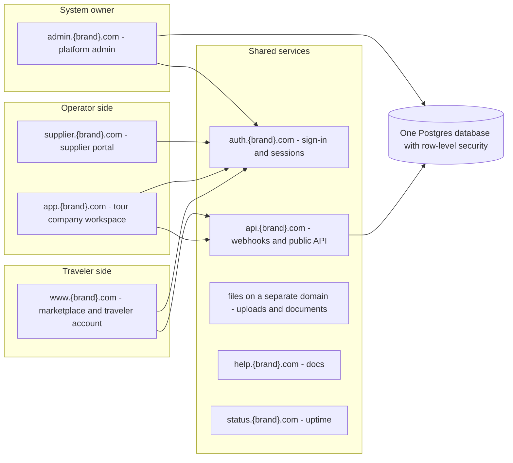
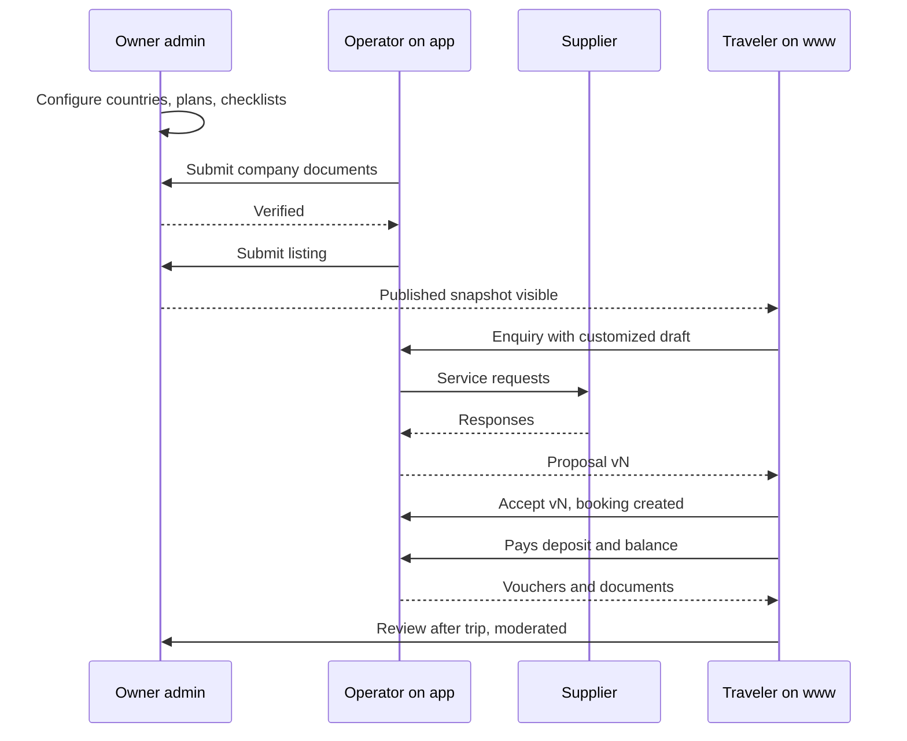

# Safari platform: domains, admin side, full process, and the ChatGPT prompt

Prepared 7 October 2026. Builds on the earlier review and recommendation.

**Assumptions I made (change them if wrong)**

- "The two operators" = **tour companies** (the operator workspace) and **service suppliers** (lodges, drivers, activity providers). Each gets its own subdomain, separate from the traveler-facing main site.
- `{brand}` is a placeholder, because the product name is still undecided. Replace it everywhere.
- One codebase, one database. Subdomains are a routing and security boundary, not separate products.
- If you actually meant two specific pilot operators, section 2.5 (company storefront subdomains) covers that.

---

## Part A. Domain map



| Host | Audience | Purpose | Sign-in |
| --- | --- | --- | --- |
| `www.{brand}.com` (also `{brand}.com`) | Travelers, public | Search, tours, operator profiles, configurator, traveler account | Optional for browsing; required for saving, enquiring, accepting |
| `app.{brand}.com` | Tour company staff | Run the business: inbox, CRM, quotes, rates, bookings, finance, team, subscription | Required, company membership checked per request |
| `supplier.{brand}.com` | Invited suppliers | Answer service requests, see confirmed services and vouchers | Required, limited grants only |
| `admin.{brand}.com` | You (platform owner) and platform staff | Verify companies, moderate, manage reference data, billing oversight, audit, support | Required, MFA enforced, strictest controls |
| `auth.{brand}.com` | Everyone | One place for sign-in, sign-up, password reset, invitation acceptance | n/a |
| `api.{brand}.com` | Machines | Payment and billing webhooks, future partner API | Signatures and keys, not user sessions |
| `help.{brand}.com` | Everyone | Guides for operators and travelers | Public |
| `status.{brand}.com` | Everyone | Uptime and incident notes | Public |
| Separate domain for files | Browsers | Stored uploads, PDFs, vouchers | Signed, expiring links |

### How the routing works

- **One Next.js application with host-based routing.** A small middleware reads the hostname and sends the request to the right route family: `www` to public and traveler routes, `app` to the workspace, `supplier` to the supplier portal, `admin` to the platform console. This matches the plan's route families (`/safaris`, `/account`, `/workspace/[companySlug]`, `/supplier`, `/platform`) without changing the code layout.
- **The host selects context but grants no access.** Every request still checks the signed-in account, the action, and the current grant (membership, supplier grant, or platform role). Revocation takes effect on the next request.
- **Language** is a path prefix (`/en`, `/sw`, `/ar` and so on) on every host, with a saved preference above browser hints.

### Security rules for the split

1. **Sessions are not shared across all subdomains.** Sharing one cookie across `*.{brand}.com` makes any single cross-site scripting bug dangerous everywhere. Preferred pattern: each host keeps its own session, and `auth.{brand}.com` signs people in then redirects back with a one-time code.
2. **Admin is the strictest host.** Mandatory multi-factor sign-in, short sessions, optional IP allowlist or VPN, no marketing scripts, no third-party widgets, separate rate limits, and every action audited.
3. **User uploads are served from a different registrable domain**, never from a `{brand}.com` host, so a hostile file cannot read cookies.
4. **Content-security policy per host**, tight on `admin` and `app`, looser only where `www` needs embeds.
5. **Webhooks live on `api`** and verify signatures, de-duplicate events and never use user sessions.
6. **Each environment has its own domains** (for example `staging-` prefixed hosts) with separate databases, credentials and synthetic data.

---

## Part B. Every host, its pages and how it works

### B1. `www.{brand}.com` - marketplace and traveler account

| Page | URL | What it does |
| --- | --- | --- |
| Home | `/` | Search by destination, duration, budget, style; featured verified operators and safaris |
| Safari search | `/safaris` | Filters, sort, map or list, shows "from" price with what it includes and whether availability is pending |
| Safari detail | `/safaris/[slug]` | Itinerary, inclusions, operator, price basis (per person or group), reviews, enquire and customize buttons |
| Customize | `/safaris/[slug]/customize` | Guided options approved by the operator (dates, party, rooms, upgrades, add-ons). Server returns selling-price estimate with assumptions and validity |
| Operators | `/operators`, `/operators/[slug]` | Verified profiles, licence status badge, listings, reviews, response time |
| Destinations | `/destinations`, `/destinations/[slug]` | Parks and regions with seasons, wildlife, practical info, linked safaris |
| Enquiry | `/enquire/[draft]` | Review draft, choose up to a limited number of operators, add contact details and message |
| Shared proposal | `/proposal/[token]` | Read, compare versions, accept or decline; link is expiring and revocable |
| Account | `/account` | Saved drafts, favorites, enquiries and conversations, proposals, bookings, documents, review prompts, profile and language |
| Booking detail | `/account/bookings/[id]` | Itinerary, travelers, payment schedule, vouchers, offline download, change or cancellation request |
| Reviews | `/account/reviews` | Write a review only for completed bookings |
| For operators | `/for-operators` | Sales page leading to `app.{brand}.com` sign-up |
| Legal and help | `/terms`, `/privacy`, `/cancellations`, `/how-it-works` | Terms, data protection, who operates the trip, how pricing works |

How it works: search and configure are open to anyone. Saving a draft, sending an enquiry or accepting a proposal needs an account. The estimate never exposes supplier costs or markups. Public data comes only from approved snapshots.

### B2. `app.{brand}.com` - tour company workspace

| Area | Pages | What it does |
| --- | --- | --- |
| Onboarding | `/start`, `/start/verify` | Company details, country, base currency, languages, licence and tax documents, branding, first staff invites |
| Dashboard | `/[company]` | Today's enquiries, proposals expiring, balances due, supplier replies waiting, listing status |
| Inbox | `/[company]/inbox` | Enquiries and conversations from storefront and marketplace in one list, with status and response timer |
| Clients | `/[company]/clients` | CRM records, scoped to the company (same email can exist in two companies) |
| Quotes | `/[company]/quotes`, `/[company]/quotes/[id]` | Quote builder from templates, versions, price breakdown, supplier requests, send proposal |
| Tours and templates | `/[company]/tours` | Author templates, allowed options, routes, seasons, inclusions; submit for publication |
| Rates | `/[company]/rates` | Private supplier contracts and rates, validity, currency, park-fee tables |
| Bookings | `/[company]/bookings`, `/[company]/bookings/[id]` | Travelers, services, capacity, documents, vouchers, amendments, cancellations |
| Finance | `/[company]/finance` | Invoices, manual payments, payment schedules, cancellation policies, supplier payables, balances |
| Suppliers | `/[company]/suppliers` | Directory, invitations, active requests, approvals |
| Storefront | `/[company]/storefront` | Public profile, listing submissions, verification status, reviews |
| Team | `/[company]/team` | Staff invites and fixed roles: owner, admin, finance, consultant |
| Settings | `/[company]/settings` | Branding, language and regional settings, tax and invoicing fields, notifications |
| Subscription | `/[company]/billing` | Plan, seats, usage, SaaS invoices, cancellation and export |
| Reports | `/[company]/reports` | Enquiry conversion, proposal turnaround, supplier response time, revenue |

How it works: one account can belong to several companies; a company switcher changes context. Consultants cannot see billing or staff settings. A sent proposal is immutable; revisions create a new version. Supplier responses never change a sent proposal until a staff member approves.

### B3. `supplier.{brand}.com` - supplier portal

| Page | URL | What it does |
| --- | --- | --- |
| Accept invitation | `/invite/[token]` | Create or link an account; the grant is limited to the requesting company |
| Requests | `/requests` | List of service requests by company and date |
| Request detail | `/requests/[id]` | Respond: available, unavailable, or price with currency and validity; add notes |
| History | `/history` | Past responses the company approved |
| Vouchers | `/vouchers` | Confirmed services with only the fields the supplier needs |
| Profile | `/profile` | Claim or edit canonical property details (first release can be read-only) |

How it works: a supplier sees only the services granted to it, never client contact lists or prices of other suppliers. A supplier can serve many companies from one account.

### B4. `admin.{brand}.com` - platform admin (the system owner)

Roles inside the platform: **owner** (you), **verifier**, **moderator**, **support**, **finance (read-only)**. Permissions are per role, and every action is written to the audit log.

| Area | Pages | What it does |
| --- | --- | --- |
| Overview | `/` | Key numbers: companies, listings, enquiries, bookings, subscription status, queue sizes, failures |
| Companies | `/companies`, `/companies/[id]` | Verification queue, documents, per-country requirements, expiry dates, approve, reject, suspend, reinstate |
| Listings | `/listings` | Review submissions, publish a specific version, withdraw, see public snapshot |
| Reviews | `/reviews` | Moderation queue, reports, remove with reason |
| Users and support | `/users`, `/support` | Look up accounts, controlled time-limited support access with reason, grant history |
| Subscriptions | `/subscriptions` | Plans, entitlements, billing events, retries, manual overrides with reason |
| Reference data | `/reference` | Destinations, parks, canonical accommodations, park fees (effective-dated), countries, currencies, FX source, locales and translation status |
| Content | `/content` | Destination pages, legal documents with versions |
| Marketplace rules | `/rules` | Enquiry caps per traveler, ranking inputs, response-time thresholds, abuse limits |
| Platform finance | `/finance` | SaaS revenue, invoices, failed payments |
| Operations | `/ops` | Notification outbox, job schedule, failed jobs, feature flags, system health |
| Audit | `/audit` | Searchable record of privileged actions |
| Security | `/security` | Staff accounts, MFA status, sessions, role changes |

How it works: owner can do everything and creates platform staff. Support access to a company is a time-limited grant that the company can see. Suspending a company removes its listings from public pages and blocks new requests; existing bookings stay visible to the parties.

### B5. `auth.{brand}.com`, `api.{brand}.com`, `help.{brand}.com`, `status.{brand}.com`

- **auth:** sign-in, sign-up, forgot password, MFA, invitation acceptance, language selection. Redirects only to an allowlist of the hosts above.
- **api:** payment and subscription webhooks (signed, de-duplicated, ordered), later a partner API.
- **help:** guides by audience; **status:** uptime and incident messages.

### 2.5 Optional: company storefront subdomains

If you want each operator to have its own branded page, use `{company}.{brand}.com` (or a custom domain later, which the plan defers). It shows only the operator's approved public content and an enquiry form that feeds that company's inbox. Treat it as a separate host for security: no workspace features, public data only, same approved snapshots as `www`.

---

## Part C. The whole process, start to end

1. **Owner setup.** You create the platform owner account, enable MFA, configure countries, currencies, locales, plans and the verification checklist per country. Seed reference data.
2. **Operator sign-up** on `app`: creates the company and owner membership, chooses base currency and languages.
3. **Verification.** Operator uploads licence, tax and identity documents. A verifier reviews in `admin`. Each document has an expiry date. Result: verified or rejected with reasons.
4. **Operator builds.** Staff are invited, suppliers added, private rates entered, templates authored with allowed options and routes, payment schedule and cancellation policy set.
5. **Listing submission and publication.** Operator submits a template for the marketplace. A moderator approves a specific version, which creates a public snapshot. Later edits do not change it silently.
6. **Traveler discovery** on `www`: search, view tour, customize within allowed options, see an estimate with assumptions and validity.
7. **Enquiry.** Traveler signs in, sends the draft to a limited number of operators. Each operator gets its own conversation. Notifications go through the outbox after commit.
8. **Quote and supplier loop.** Operator builds a quote version, requests availability and prices from suppliers on `supplier`, reviews responses, approves.
9. **Proposal.** Operator sends version N with price, expiry, terms and authorized recipient. Revisions create version N+1.
10. **Acceptance.** Traveler accepts a specific version. One transaction validates actor, version, expiry, status and capacity, and creates one booking. Retries do not duplicate.
11. **Payment.** Deposit and balance follow the payment schedule. Traveler pays through the operator's channel; the operator records payments; the system reconciles, issues invoices and sends reminders.
12. **Pre-trip.** Traveler completes traveler details and checklist; vouchers and itinerary are issued; an offline copy is available. Supplier confirmations are tracked.
13. **Changes and cancellations.** Amendments create a new priced version; cancellations compute refunds from the policy attached at acceptance.
14. **Trip and support.** Emergency contacts and operator contact are visible; incidents are logged by the operator.
15. **After the trip.** Booking completes; review invitation goes only to eligible travelers; moderator handles reports.
16. **Operator billing.** Subscription plan, seats and entitlements are enforced server-side; failed payments lead to grace, then read-only with export; cancellation preserves data for the stated period.
17. **Ongoing compliance.** Scheduled jobs warn about expiring licences and suspend listings when they lapse; admin reviews audit and failures.
18. **Offboarding.** Company exports data; access is revoked; public listings are withdrawn.



---

## Part D. The prompt to send to ChatGPT

**Before you send it, fill in the three bracketed items at the top** (brand, access to your existing platform, launch countries). If ChatGPT cannot open your repository, upload a zip, or paste the folder tree plus the main files, and it will ask for specifics.

```text
ROLE
You are a senior product architect, full-stack engineer and technical writer. You will produce a complete, build-ready specification and then a first-sprint plan for a NEW multi-tenant safari platform. Be precise, structured and honest about what you cannot see.

STEP 0 - INSPECT MY EXISTING SAFARI PLATFORM FIRST
My existing safari platform is here: [PASTE REPOSITORY LINK, UPLOAD ZIP, OR PASTE FILE TREE AND KEY FILES].
Treat it as READ-ONLY. Do not propose changing it or connecting the new product to its production services.
Audit it and report, before designing anything:
1. Features it already has (pricing, quoting, bookings, invoices, suppliers, roles, languages, documents).
2. Reusable domain logic (pricing, rate resolution, balances, invoicing) and which tests actually run.
3. Weaknesses: missing or incomplete schema, broad privileged database access, missing tenant isolation, missing tests.
4. Ideas worth carrying over, ideas to drop, and ideas I should add.
If you cannot access something, list exactly what you could not see and what you need. Do NOT invent or assume contents.

PRODUCT
Brand: [BRAND, or "temporary internal name"]. Launch countries: [E.G. KENYA, TANZANIA]. Safari destinations first.
A subscription product for tour companies, connected to a shared traveler marketplace. Travelers discover verified operators and customize approved safari templates. Companies manage enquiries, proposals, bookings and basic finance. Invited service suppliers confirm assigned services. The platform owner administers the whole system.
Model: company subscriptions; operators manage traveler payments at launch (the platform does NOT hold traveler funds); curated safari templates; private safaris on request. Post-launch (do not build now, but do not block): free-form AI itinerary assembly, affiliate commissions, custom company domains, company WhatsApp, live inventory, platform-held payments, automated payouts.

DOMAINS AND HOSTS (one codebase, one database, host-based routing)
- www.{brand}.com : public marketplace and traveler account
- app.{brand}.com : tour company workspace
- supplier.{brand}.com : supplier portal
- admin.{brand}.com : platform owner/staff admin
- auth.{brand}.com : sign-in, sign-up, MFA, invitations
- api.{brand}.com : signed webhooks, future public API
- help.{brand}.com and status.{brand}.com
- Optional later: {company}.{brand}.com storefronts. User uploads served from a separate registrable domain.
Rules: the host selects context but never grants access; every request checks the account, the action and the current grant; each host keeps its own session with sign-in via auth host redirect; admin requires MFA, short sessions and full audit; per-host content-security policy; separate environments with separate databases and credentials.

ACTORS AND ROLES
Traveler; company staff (owner, admin, finance, consultant); supplier; platform staff (owner, verifier, moderator, support, finance read-only). One account may hold several company memberships or supplier grants. Revocation applies on the next request. Never rely on stale role claims.

PRIOR RESEARCH AND CRITIQUE TO BUILD IN
Verify each fact yourself before relying on it, and flag anything you cannot confirm.
Market research:
- Wetu: content hub plus itinerary builder. Suppliers list free, operators pay for tools (paid plans reported from about $75/month by a competitor page). Machine translation in 11 languages, offline traveler app, integrations with back-office systems such as Tourplan. Its moat is shared supplier content.
- Waybird: itineraries plus payments and host-agency services; Lite plan about $199/month per its own page.
- Tourplan: back-office system for tour operators and DMCs.
- SafariBookings: lead-generation marketplace. Operators pay per quote request; about 6 requests are needed per confirmed booking and about 20% of requests go unanswered. It collects licence, tax clearance and shareholder KYC documents.
- TourRadar: multi-day tour marketplace. Marketplace channel fee about 15.25% plus 1.75% tech fee plus up to about 3% payments, versus direct-booking tooling with no channel fee. It holds customer payments and splits them; operators are paid around departure.
- Tukio (Kenya): component cart and smart wizard. Its stated challenges are trust, awareness and dependence on partner reliability.
Lessons: scalers own content, demand or payments; fan-out enquiries are noisy; trust and verification are the product; direct tooling is cheaper than channel fees; a configurator needs trustworthy supplier data behind it.

Critique findings that the design must address:
1. No demand or monetization logic. Recommended: workspace first; subscription only at launch (Option A); add a per-qualified-enquiry fee later (Option B) once demand is proven; commission only if the platform later holds funds (Option C). Include a traveler acquisition plan (SEO, destination content, reviews, partnerships) and metrics: visit to estimate to enquiry to proposal to booking, cost per acquired traveler, operator retention, lead-to-booking ratio, response time, proposal turnaround.
2. Legal role undefined: seller of record, EU package travel rules for customized packages, UK and US rules, data protection. Working stance: the platform is software and listing venue, the operator is the contracting party; confirm with counsel.
3. Payments not proven: verify provider eligibility per launch country (Stripe documentation lists Kenya and Tanzania but it is unclear whether local accounts or only cross-border payouts are supported), include local payment methods, build a payment schedule and cancellation engine, keep a ledger-ready data model.
4. Content and supply moat: supplier claim flow for canonical properties, operator-contributed content with moderation, supplier-maintained content later; investigate import or partnership options without assuming they exist.
5. Estimates were optimistic, especially the pricing and quoting core. My adjusted range is about 37-54 engineering person-weeks versus the original 30-44; state what is excluded.
6. Lifecycle after acceptance: amendments, cancellations, refunds, reminders, pre-trip documents, offline access.
7. Verification: per-country document matrix, expiry dates, renewal reminders, automatic suspension (Kenya's regulator issued a 20 July 2026 advisory telling online platforms to verify partners' licences).
8. Operations: scheduler, observability, and row-level security performance patterns.
9. Enquiry fan-out: caps, response expectations, lead-quality signals, rate limits.
10. If time is tight, cut or defer: favorites, shared-draft links, supplier vouchers, public display of reviews, second language.

REQUIRED OUTPUT (in this order, as separate clearly titled sections)
1. Existing-platform audit (Step 0).
2. Product scope: in scope, out of scope, assumptions, open decisions with a recommended default for each.
3. Domain and routing design: every host, its audience, session and security rules, redirects, cookies, DNS and environment plan.
4. Page-by-page specification for EVERY page on EVERY host. For each page give: URL, who may open it, purpose, data shown, actions, validations, states (loading, empty, pending, expired, unavailable, denied, error, retry), notifications triggered, audit events, edge cases, and acceptance tests.
5. Admin (platform owner) specification in full: dashboard, company verification with per-country document matrix and expiry, listing publication and withdrawal, review moderation, users and controlled support access, subscriptions and billing events, reference data (destinations, parks, canonical accommodations, effective-dated park fees, currencies, FX source, locales), content, marketplace rules, platform finance, operations (outbox, jobs, flags), audit, security.
6. End-to-end process from start to finish: owner setup, operator sign-up, verification, content and rates, listing publication, traveler discovery, configurator, enquiry, quote, supplier loop, proposal, acceptance, payment schedule, pre-trip, amendments, cancellations, trip, review, subscription lifecycle, licence expiry, offboarding. Provide a state machine and a sequence diagram for each major flow (Mermaid).
7. Data model: every table with owner class (platform reference, company private, traveler owned, deliberately shared, public, platform private), keys, composite foreign keys to bind children to the same company, per-company uniqueness and numbering, indexes, row-level security policies (allowed and denied cases), storage rules.
8. Service contracts: estimate (server returns selling price, currency, assumptions, validity, availability status; never supplier cost or markup), publication (specific public version; withdrawal invalidates caches), enquiry (one conversation per selected operator, outbox after commit), proposal (immutable versions, expiry, terms, authorized recipient), acceptance (single transaction, idempotent, capacity checked), supplier response (company approval before it changes a customer proposal), amendment, cancellation and refund (computed from the policy attached at acceptance), subscription (signed, de-duplicated, ordered events; server-side entitlements).
9. Commercial policy engine: payment schedules, deposits, cancellation tiers, refund rules, currencies and rounding, taxes by country.
10. Pricing rules: seasons, child ages, room sharing, group size, park fees by residency and age, effective-dated rates, missing or expired rates, permitted option combinations, separate base, contract, proposal, invoice and display currencies with labeled FX rate and time.
11. Compliance: licence verification per launch country with expiry, renewal reminders and automatic suspension; consumer-protection and seller-of-record questions to confirm with counsel; data protection for traveler passport, dietary and health data (minimization, retention, transfer); never log sensitive fields.
12. Integrations: payment adapter (verify provider eligibility per launch country, include local payment methods and manual recording), subscription billing, transactional email, FX rates, PDF generation, translation with review status, accounting export, calendar files, bot protection, search. For each: recommended option, fallback, risks, what to verify.
13. Internationalization: locale-keyed message catalogues and content, fallback rules, explicit language choice over browser hints, RTL and LTR, long strings, regional formats, UTC timestamps with IANA time zones, date-only seasons that never shift, locale-specific URLs and alternate-language metadata.
14. Traveler experience details: estimate wording (per person or group, inclusions, who operates the trip, availability pending), offline itinerary and voucher access, accessibility, mobile first.
15. Notifications catalogue: every event, recipient, channel, template, retry rule.
16. Scheduler and operations: expiry of quotes, rates and licences; payment reminders; FX refresh; retries; observability, alerts, backup and restore drill, rollback limits.
17. Security: threat model, abuse controls, rate limits, enquiry fan-out limits and response-time rules, audit catalogue, secrets handling, admin hardening.
18. Test plan: database allow/deny for every tenant table and storage path, cross-company relation rejection, concurrent duplicate acceptance, capacity oversell, expired or superseded offers, immutable issued invoices, pricing boundaries, token expiry and revocation, publication visibility, billing replay and out-of-order events, end-to-end journey with two companies.
19. Roadmap: milestones with dependencies, effort ranges in person-weeks, exit gates. Re-sequence as: validation phase (legal, payments, pilot operators) in parallel; foundation; tenancy and identity; operator workspace including the policy engine; public operator storefront and verification; marketplace and configurator; traveler journey and lifecycle; supplier collaboration; paid workspace; pilot and launch. Reuse one pricing engine for operator quotes and public estimates. Give an honest range and say what it excludes (legal, content, design, translation, training, hosting, traveler acquisition).
20. Sprint 1 and Sprint 2 task lists with concrete outputs and acceptance criteria.
21. Risks, unknowns and decisions I must make, each with owner and recommended default.
22. Competitor analysis and positioning: a table of Wetu, Tourplan, Waybird, SafariBookings, TourRadar, Tukio and any others you find, with model, who pays, strengths and gaps, plus the wedge features that would make a company switch.
23. Revenue model and pricing hypotheses with trade-offs, and the tests to run with pilot operators.
24. Go-to-market: operator acquisition, traveler acquisition, pilot plan, success metrics and launch gates.
25. Content and supply strategy: seed catalogue, canonical accommodation identities, supplier claim and merge flow, translation workflow.

CONSTRAINTS
- New repository, separate database, storage, authentication configuration, integration credentials and environments. Never write to the original platform's services. Synthetic data only for pilots; historical migration is a separate task.
- Stack: one modular Next.js and TypeScript app with Supabase Postgres, Auth and Storage; pure pricing and accounting rules in a separate tested package; migrations, seeds and environment variable names in version control, secret values never. Verify current supported versions and pin dependencies; tell me where you are unsure.
- Row-level security on every exposed table with explicit grants; wrap auth calls in subselects, index policy columns and use stable permission helper functions; never make the service-role client the default query path.
- Public data only from approved snapshots with allowlisted fields. No fictional ratings, no copied competitor content.
- Do not claim code, tests or deployments exist. This is specification and planning.
- No legal, tax or financial advice: flag items to confirm with qualified professionals.

STYLE
- Be specific and concrete; use tables for pages, permissions and tables; Mermaid for flows.
- Label every assumption. Separate facts you verified from things you recommend.
- Where a choice is open, give a default and the trade-off in one or two lines.
- If the answer is too long for one reply, deliver the sections in order, say which section comes next, and continue when I reply "next". Do not skip sections or summarize them away.
- Start with Step 0 and ask me at most five questions that block the design; otherwise proceed with stated assumptions.
```

---

## Notes on using it

- Send it in a fresh ChatGPT conversation with your existing repository attached or linked. ChatGPT cannot see a private repository unless you provide it, which is why the prompt makes it list what it could not see instead of guessing.
- Expect to reply "next" several times; the output is large.
- Keep the earlier plan and my review open as the reference to check ChatGPT's answers against, especially the cancellation and payment-schedule engine, licence expiry, and the rule that the platform does not hold traveler funds at launch.