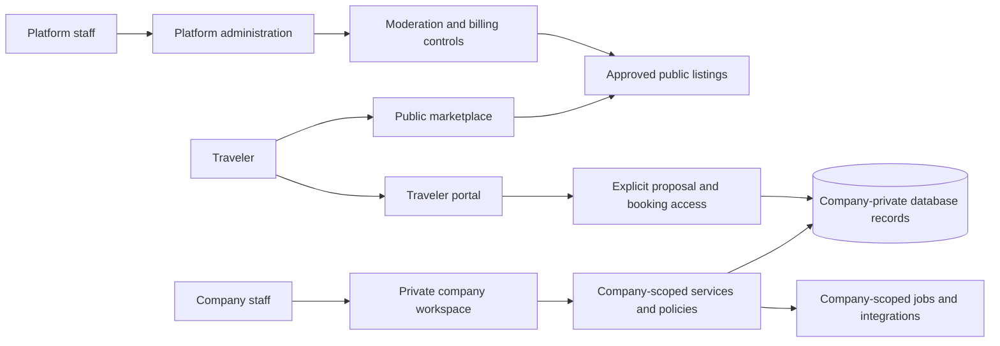

# Safari Platform — system review and detailed upgrade plan

Review date: 7 October 2026.

## 1. Recommendation and scope

Create a separate multi-tenant SaaS product for tour companies, connected to a shared client marketplace. Reuse the existing application's itinerary, pricing, accounting, and operational concepts selectively. Build the tenant foundation and marketplace publication model before exposing company workspaces to customers.

The original `issaa-safari/Safari-duplicate` repository and its production services must remain untouched. This review made no repository commits, database changes, deployments, or submissions to tour operators. Source material was copied into a separate local research folder.

The product has two separate promises:

1. **To companies:** a private workspace to run their safari business, sold by subscription.
2. **To travelers:** a trustworthy marketplace to discover operators, compare safaris, request proposals, and manage bookings.

Owning a paid workspace does not automatically approve a company for marketplace publication. An operator's suppliers—hotels, guides, parks, transport providers—are not automatically paying company tenants.

## 2. Review method and limits

Repository snapshot: [b8e860942bb85a6bff8fab8c07fdfc2e3d434c84](https://github.com/issaa-safari/Safari-duplicate/tree/b8e860942bb85a6bff8fab8c07fdfc2e3d434c84). Its tree contains 771 tracked files, including 450 files under app/components/lib, 93 group migration files, and 25 TypeScript test files.

The review indexed the complete repository tree and collected 290 selected source/schema/test/configuration files at that snapshot, including all 93 group migrations and all 25 test files. It inspected current public/client flows, server actions, API handlers, shared services, pricing/accounting modules, schema definitions, database functions, and verification configuration. It is a substantial static architecture and workflow review, not a claim that every line of every component was manually audited. The source manifest is in `safari-review-evidence.json`.

SafariBookings research used public page content and official operator-help articles: home/search, tour details, itinerary, rates, offered-by profile, quote request, operator directory, favorites, destination guide, partner terms, ranking policy, company verification, tour moderation, reviews, and operator tour/availability guidance.

Limits:

- Shell access to external sites failed because the configured proxy was unreachable; GitHub and web connectors supplied research material.
- No production database or authenticated company/client session was used.
- Your configured public domain timed out through the web fetcher. Its rendered interface was not inspected.
- SafariBookings was inspected through fetched page content, not an interactive browser. No form was submitted. JavaScript behavior, mobile visual quality, accessibility, and authenticated operator screens were not tested.
- Operator features behind login are supported by official documentation, not by direct account access.
- Existing tests and CI were inspected. Passing runtime tests, builds, database replay, and production correctness are not established by this review.
- An offline dependency installation in the research copy failed with `ENOTCACHED` for a required package. No Postgres client/runtime was found. Accordingly, the test suite, production build, and database replay were not run.

The estimates below are planning ranges and must be refined after an isolated runnable checkout, database reconstruction, and pilot feedback.

## 3. Your existing system: what is valuable

| Capability | Evidence at the reviewed snapshot | Reuse decision |
|---|---|---|
| EN/AR and RTL | `lib/locale.ts`, `lib/i18n.ts`, public pages and bilingual proposal fields | Existing capability; generalize to configurable international locales rather than retaining a two-language product boundary |
| Tour catalogue and public itineraries | `app/(public)/tours/`, public tour components, tour/day schema | Adapt authoring and presentation; replace the discovery layer |
| Fixed departures and direct booking | departure pages/API, `lib/server/create-booking.ts` | Preserve concept and capacity rules; add tenant and public-publication boundaries |
| CRM and request pipeline | request actions, clients service, unified enquiry intake | Adapt to company-private records and marketplace enquiry routing |
| Versioned quote builder | quote actions, trip builder, quote/version/day/item model | Major reusable product capability; tenantize every lookup, write, template, and share link |
| Pricing | `lib/rate-resolution.ts`, `lib/per-person-cost.ts`, `lib/pricing.ts` | Reuse pure calculations after regression checks; separate private cost rates from public selling rates |
| Atomic booking services | quote/departure/manual booking services and migrations 95/96 onward | Preserve transactional design; add tenant binding, authorization, and real DB concurrency tests |
| Trip accounting | `lib/balance.ts`, `lib/invoice.ts`, accounting/invoice services, accounting documentation | Preserve shared arithmetic and immutable issued-invoice approach |
| Supplier operations | supplier records, rate cards, supplier payments, payables | Keep as private company resources; independent supplier portals are a later product |
| Team controls, MFA, audit | team actions, auth middleware, `lib/server/audit.ts` | Present today; strengthen company permissions and invitations rather than call these entirely missing |
| Operations | vouchers, agreements, rooming, staff/vehicle resources, trip packs | Reuse progressively after core sales flow works across companies |
| Automation and integrations | daily cron, WhatsApp webhook/flows, email, MCP intake | Redesign routing/configuration for each company; do not copy global credentials |
| Verification | 25 test files; CI installs, type-checks, tests, builds | Retain and expand to database authorization and end-to-end workflows |

The old `docs/current/feature-roadmap.md` is a dated SafariOffice comparison. Current code contains later additions; that document is not reliable evidence that MFA, team editing, audit logging, or invoice workflows are still missing.

## 4. Concrete architectural gaps in your system

These are barriers to the proposed multi-tenant product, not claims that the current single-operator deployment is broken or compromised.

| ID | Observed behavior | Why it matters | Required change |
|---|---|---|---|
| A01 | `getAdminProfile` identifies active admin membership by email; `assertAdminAccess` checks membership without requiring a particular action permission | Existing role labels do not provide the company/finance/team permission model you need | Membership keyed by auth user ID and company; server permission checks for every operation |
| A02 | Team actions use that general admin guard and expose role/active editing | Staff-management permissions need independent enforcement | Company owner/admin permissions; explicit invites, revocation, and last-owner protection |
| A03 | Many screens/actions/services use a privileged Supabase client | Adding RLS does not constrain a service-role query that bypasses it | Prefer caller-scoped clients; narrowly authorize and constrain privileged operations |
| A04 | `findOrCreateClientByEmail` searches clients without company scope | Two companies must not share private CRM records merely because a traveler uses the same email | Company-specific client dedupe and global traveler identity kept separate |
| A05 | Client dashboard ownership is inferred from traveler-email matching | Group membership and access to sensitive traveler details need explicit permissions | Booking account access and group roles linked to auth user IDs |
| A06 | `company_settings` is modeled as one row; services/functions select first settings | Rates, payment instructions, deposit rules, and document prefixes would mix across companies | One settings record per company; all reads explicitly company-bound |
| A07 | `lib/site.ts`, email notifications, WhatsApp environment variables, and MCP token assume one brand/operator | Leads and documents can be routed or branded incorrectly after expansion | Platform identity separate from company identity; company integration bindings and scoped credentials |
| A08 | Public tours filter by active/show-on-website and bike/private type; cards are alphabetically ordered and do not provide a marketplace price/rating/search model | Cross-operator discovery requires more than the current grid | Approved listing projection, normalized facets, contextual public selling prices, pagination, ranking |
| A09 | Public supplier records are not seller accounts; supplier types are accommodation/transport/park/activity/staff/other | Internal payables records cannot serve as tour-company tenancy | Companies/memberships/operator profiles separate from internal suppliers |
| A10 | Upload API uses one public tour-media bucket with generic folder paths | Private documents and company media need different access rules | Company media ownership, private buckets, upload authorization, approved public assets |
| A11 | Finance services aggregate all invoices/payments or supplier balances for the single system | Reporting must never aggregate unrelated company records | Tenant-filtered aggregates, server pagination, tenant indexes, permission checks |
| A12 | Request/invoice numbering and tour slug assumptions are global | Companies need their own numbering; marketplace routes need unique identities | Atomic company-specific counters; per-company slug uniqueness and stable public IDs |
| A13 | Public request rate limiting is an in-process Map | Multiple server instances do not share limits | Durable/distributed limits, tenant/endpoint-aware quotas, abuse controls |
| A14 | Daily cron processes the system using global settings and privileged queries | Retention, follow-up, and notifications must obey each company's settings | Company-scoped jobs, retries, audit, and explicit processing boundaries |
| A15 | Documented consolidated baseline contains no CREATE TABLE definitions despite its fresh-setup instructions | It cannot by itself establish the documented application schema in a new database | Reconstruct and verify a clean, complete schema in the new project before reuse |
| A16 | Inspected booking tests mock RPC calls and error responses | They do not demonstrate SQL locking, real capacity handling, or tenant isolation | Integration tests against actual Postgres/Supabase and concurrent booking attempts |

A15 is a static observation of `migrations/baseline/002_schema.sql`, not a completed database-replay experiment. Use the existing group migrations and actual schema knowledge to investigate; do not assume a healthy live database can be reproduced from the baseline's comments.

## 5. SafariBookings: evidence and implications

The following observations are deliberately brief. Recommendations in the final column are for your product, not claims about SafariBookings' hidden implementation.

| Area | Publicly observed or officially documented | Implication for your product |
|---|---|---|
| Search | Destination, dates/flexibility, traveler counts/ages; filters for duration, price, comfort, private/shared, accommodation style, rating, specialty, operator, and other attributes | Normalize catalogue attributes; save search context across results/detail/enquiry. [Tour search](https://www.safaribookings.com/tours) |
| Tour detail | Route, itinerary, accommodation/meals, features, transport, inclusions, and operator identity | Build a consistent detail template rather than company-specific freeform marketing pages. [Example tour](https://www.safaribookings.com/tours/t74596), [itinerary](https://www.safaribookings.com/day/t74596) |
| Rates | Example rates vary by season and party configuration and state eligibility/exclusions | Show pricing assumptions; do not calculate marketplace sale prices directly from private supplier costs. [Example rates](https://www.safaribookings.com/rates/t74596) |
| Enquiries | Form collects identity/contact, trip context, and message; chosen operator emails the quote | First release can support enquiry-led booking with a stronger integrated proposal workspace. [Quote form](https://www.safaribookings.com/request-quote/t74596) |
| Operator discovery | Operator directory and profiles expose office, specialties, destinations, reviews, and offered tours | Separate seller profiles from private company settings. [Directory](https://www.safaribookings.com/operators), [example profile](https://www.safaribookings.com/operator/t74596) |
| Saved choices | Favorites supports saved tours/operators and cross-device access | Implement account-backed favorites. A side-by-side comparison table is your proposed addition, not verified here as SafariBookings functionality. [Favorites](https://www.safaribookings.com/favorites) |
| Commercial model | Account/review services free; tour advertising charges per quote request; partner agreement describes advertising credit | Do not confuse your SaaS subscription with lead charging or commissions. [Partner options](https://www.safaribookings.com/partner-options/safari-companies), [agreement](https://www.safaribookings.com/partnership-agreement-for-tour-operators) |
| Ranking | Performance, relevance, and paid placement influence ranking; paid placement does not override filters | Start with transparent relevance/quality ranking; label any paid promotion later. [Ranking policy](https://www.safaribookings.com/faq/rankings-and-results) |
| Company verification | Operator licenses/business documents and identity are part of onboarding; documentation is refreshed | Build a real verification workflow before displaying verification claims. Define your own country-specific requirements. [Verification](https://www.safaribookings.com/trusted-safari-companies) |
| Listing moderation | New tours manually reviewed; amended sections rechecked | Versioned submissions and approvals; company edits cannot silently alter an approved listing. [Quality policy](https://www.safaribookings.com/tour-quality-and-transparency) |
| Reviews | Moderated reviews; operators may respond but cannot edit/delete traveler reviews; outside-platform completed trips can qualify | Launch with booking-linked, moderated reviews; wider proof-of-travel review intake can follow. [Review policy](https://www.safaribookings.com/genuine-reviews) |
| Operator authoring | Official help describes draft saving, preview, tour sections, day-by-day accommodation/meals, and rates/availability | Reuse your authoring engine, adding marketplace completeness and submission checks. [Tour creation](https://help.safaribookings.com/hc/en-150/articles/20201241240221-Creating-a-Tour-on-SafariBookings) |
| Availability | Official help describes date availability and shared-group resource constraints | Distinguish available, unavailable, on-request, and fixed-departure capacity. [Availability help](https://help.safaribookings.com/hc/en-150/articles/19360857532189-Setting-Up-Availability-for-Shared-Group-Tours-That-Can-Depart-on-Any-Day) |
| Destination content | Kenya guide connects travel information, parks, reviews, and relevant tours | Build original/authorized destination content gradually; keep it distinct from operator reviews. [Kenya guide](https://www.safaribookings.com/kenya) |

Do not copy competitor content, images, review data, or exact interface assets. Use the demonstrated information structure and workflows as references.

## 6. Feature gap and launch boundary

| Feature | Current system | Pilot / public launch | Later |
|---|---|---|---|
| Company tenancy and switching | Not the existing model | Required for pilot | Enterprise isolation options if justified |
| Invitations and granular roles | Team editing exists; company model absent | Required for pilot | Custom role builder |
| Workspace subscriptions | Not identified in reviewed routes/services | Before paid launch | Annual pricing, advanced billing controls |
| Tour authoring and private cost library | Substantial existing capability | Adapt for pilot | Bulk import and collaborative editing |
| Operator verification and listing approval | No marketplace workflow identified | Required before public listings | Automated document checks |
| Public search, rates, operator profiles | Single-brand tours only | Required for public launch | Advanced relevance and map search |
| Favorites and comparison | No corresponding routes identified | Public launch | Shareable shortlists |
| Enquiries and proposals | Existing pipeline and quotes | Adapt for pilot and public launch | Email reply ingestion and channel integrations |
| Client booking access | Email-matched portal exists | Explicit ownership required | Rich traveler collaboration |
| Reviews | Placeholder schema is not a review product | Moderated booking-linked reviews for public launch | External proof-of-travel intake, widgets |
| Finance, supplier records, invoices | Existing modules | Basic tenant-safe payments/invoices for pilot | Expanded reports and supplier portals |
| Safari payment processing/payouts | Manual recording is not payment collection | Outside platform initially | Separate commercial/payment project |
| Custom domains/white-label sites | One brand/domain | Company-branded documents/profile | Custom websites and verified sender domains |
| Motorbike features | Existing specialist functionality | Optional company capability | Additional specialist verticals |
| AI/MCP, WhatsApp integrations | Global integration assumptions | Defer until safely company-scoped | Company-connected integrations |

Recommended defaults, not final commercial decisions: tour-company tenants; international audience and configurable locales; initial destination/translation coverage to be selected; subscription revenue; enquiry/quote workflow; no platform-held traveler funds. Do not advertise guaranteed traffic or bookings with a SaaS subscription.

## 7. Architecture and data model

Use a modular Next.js application with Postgres/Supabase Auth and Storage initially. Avoid splitting into microservices before real scale demands it. Preserve pure pricing/accounting modules in shared packages or clearly separated modules. The public marketplace and private workspaces can be in one application, but require separate query models and authorization paths.

### Ownership categories

| Category | Records | Access |
|---|---|---|
| Platform-global reference | Countries, canonical parks/destinations, approved accommodation identities | Public read where intended; platform-controlled writes |
| Company-private | Clients, supplier contracts/rates, quotes, bookings, finance, vehicles/staff, notes, files | Active company membership plus action permission |
| Traveler-owned | Account profile, favorites, trip requests, preferences | Account owner; chosen data shared with explicit enquiry recipients |
| Intentionally public | Approved operator profiles and listing snapshots, published review summaries | Public read of approved projection only |
| Platform-private | Billing events, document verification, moderation records, support grants | Specific platform roles; sensitive support access audited |

### Core schema additions and changes

- `companies`: stable ID, workspace slug, lifecycle status, timezone, locale; do not store billing and verification in one overloaded status.
- `company_memberships`: company ID + auth user ID, role, active/revoked state; unique company/user pair. Staff can belong to multiple companies.
- `company_invitations`: email, intended role, expiring hashed token, inviter, acceptance/revocation. Invitations confer no access until accepted.
- `company_settings`: exactly one per company; branding, payment instructions, quote defaults, company-specific currency/FX settings.
- `subscriptions`, `plans`, `entitlements`, `billing_events`: provider references and idempotent webhook processing. Keep customer safari invoices separate.
- `operator_profiles`, `verification_documents`, `verification_decisions`: public profile plus private evidence and verification expiry/history.
- `tours`, `tour_versions`, `listing_submissions`, `published_listings`: private working versions and explicit immutable approved public versions.
- `tour_destinations`, `tour_features`, `tour_accommodations`: normalized relationships for search. Company-private descriptions/rates remain separate from canonical reference identities.
- `public_rate_rules`: currency, validity dates, adult/child/group eligibility, room basis, price range and inclusions; separate from private cost cards.
- `availability_rules` and `departures`: private/on-request date rules versus capacity-controlled group departures; no false real-time lodge availability claims.
- `trip_requests`, `enquiry_recipients`: traveler request with separate company-specific recipients, listing/price snapshots, and consent records.
- `conversations`, `messages`, `attachments`: each operator sees only its own conversation with the traveler.
- `company_clients`: company-private CRM identity; optional traveler account relation. Same email in two companies is two CRM records.
- `quotes`, `quote_versions`, `quote_days`, `quote_items`: company ownership at every level; accepted content immutable; quote delivery bound to company and version.
- `bookings`, `booking_account_access`, `booking_travelers`: booking purchaser/lead and invited traveler roles; do not expose the whole roster to every group member.
- `trip_payments`, `invoices`, `invoice_lines`, `supplier_payments`: retain concepts with company-bound references, immutable issue rules, and company-specific counters.
- `reviews`, `review_invitations`, `review_responses`, `moderation_cases`: booking-linked eligibility, moderation history, published-only rating aggregates.
- `integration_connections`, `job_runs`, `notification_outbox`, `audit_events`: company-scoped integrations, idempotent jobs, reliable post-commit delivery, traceability.

### Database rules

Every company-private table has non-null `company_id`. Use composite constraints to bind children to a parent in the same company: for example, `(company_id, quote_id)` references a unique `(company_id, id)` on quotes. Permission policies validate live membership and action rights; request-provided company IDs never establish authority.

Company-private uniqueness includes company scope: normalized client email, supplier names where appropriate, internal tour slugs, invoice numbers, and integration event IDs. Public listings have globally stable IDs; company-specific sequential document numbers are allocated atomically.

Approved public snapshots contain only allowlisted public fields. Never publish private rates, markup, customer information, internal notes, verification documents, or draft content. Suspension/unpublication must remove results and invalidate caches/search projections promptly.

Supabase service-role access bypasses RLS; it must remain server-side and narrowly constrained. Storage needs its own ownership rules. These boundaries follow [Supabase RLS guidance](https://supabase.com/docs/guides/database/postgres/row-level-security) and [Storage access-control guidance](https://supabase.com/docs/guides/storage/security/access-control).

### Permission matrix

| Action | Traveler | Company consultant | Company finance | Company admin/owner | Platform moderator |
|---|---|---|---|---|---|
| View public approved tours | Yes | Yes | Yes | Yes | Yes |
| View private company clients/quotes | Own shared proposals only | Assigned/company scope per permission | Billing data needed for role | Own company | No default private access |
| Change listings/submit | No | Explicit catalogue permission | No | Own company | Approve/reject public submissions |
| Send/accept proposal | Accept own | Send if authorized | No by default | Own company | No default |
| Record money/issue invoices | No | No by default | Own company | Own company | No default |
| Invite staff/change roles | No | No | No | Admin; owner-only ownership transfer | No ordinary workspace access |
| Manage subscription | No | No | Explicit billing permission | Owner/billing admin | Dedicated platform billing role |
| Submit/respond to reviews | Own eligible trip | Respond if authorized | No | Respond for own company | Moderate, with recorded reasons |

## 8. Screen map and experience requirements

### Public marketplace

- Home: destination/date/party search, selected destinations, real trust information, operator signup link.
- Results: filters, active-filter chips, contextual price, route, comfort/type, operator name/rating, save action, pagination, explicit availability state.
- Tour detail: overview, route map, day-by-day, accommodation/meals, rates/eligibility, inclusions/exclusions, operator, reviews, persistent quote action.
- Operator directory/profile: country/office, specialisms, reviewed verification status, tours, review history, direct/custom enquiry.
- Saved tours/operators and proposed comparison: compare at most three tours initially; same date/party/currency context; visibly mark different inclusions or unknown prices.
- Destination guide: original content with reviewed date, useful route/season guidance, and links to relevant tours.
- Quote request: low-friction contact/trip form; retain search context; guest submission supported with verified email before granting private account access.

### Traveler account

- Overview, favorites, requests, separate operator conversations, proposals, proposal comparison, bookings, documents, profile/security.
- Explain who fulfills each trip and whom to contact. Show operator-specific conditions and accepted-price snapshot.
- Booking lead can invite a traveler to enter their own details. Other passengers' passport/medical fields are never exposed by default.

### Company workspace

- Onboarding checklist; company switcher; dashboard with real enquiry and response metrics.
- Sales inbox, CRM clients, request detail, tasks, notes, conversation.
- Tour authoring, library, rates, departures, marketplace submissions/status.
- Existing itinerary builder adapted with company-only lookups, pricing warnings, proposal versions, share/send/accept state.
- Booking operations, travelers, assignments, agreements, vouchers, trip packs.
- Finance: invoices, receipts, balances, supplier payables; separate booking deposits from refundable equipment/security deposits.
- Settings: staff/invites/permissions, branding, defaults, subscription, integrations, audit activity.

### Platform administration

- Companies, verification queue, listing review with version diff, reviews/reports, subscription events, support cases, reference content, platform metrics.
- Support access to private company records requires a time-bound grant and recorded purpose. Marketplace moderation should work from submitted/public content without ordinary CRM access.

### Layout and usability

Marketplace pages prioritize search and comparison; company pages prioritize pipeline speed. Use a common accessible component foundation, with configurable locales and LTR/RTL behavior. Mobile filters open in an accessible sheet; request/quote actions remain reachable. Do not promise a best-price guarantee or show ratings/badges until their supporting process and data exist.

## 9. Critical workflows and state rules

1. **Company onboarding:** verified account → company creation → owner membership → trial/subscription entitlement → private workspace. Marketplace verification is a separate application.
2. **Publication:** private draft → validated version → submitted → changes requested/approved → published snapshot. Material edits create a new review submission; old approved version stays explicit or is withdrawn according to policy.
3. **Enquiry:** chosen listing/operator → contact and trip validation → atomic request + company recipient → notification outbox → company CRM request. Retries use an idempotency key scoped to recipient/company.
4. **Multiple quotes:** traveler explicitly selects additional operators; each receives a separate recipient/conversation. No competing messages, costs, or proposal content visible to other operators. Receiving several proposals does not create several bookings.
5. **Proposal:** consultant edits draft → resolves private rates → confirms selling price → sends bound version → traveler views → accepts or declines. Unpriced/missing-date proposals cannot become confirmed bookings.
6. **Acceptance:** authenticate account or validate narrow share-token authority → lock proposal/departure → enforce ownership/version/status/expiry/capacity → create one booking and price snapshot → record acceptance → enqueue notification. Retry returns a stable result or explicit existing-booking response without duplication.
7. **Invoice/payment:** draft → issue immutable document → record payment/refund → derive balances from ledger. Changes require void/reissue or the applicable accounting correction process; no arbitrary editing of issued totals.
8. **Reviews:** completed eligible booking → invite → traveler review → moderation → publication → operator response. Operators cannot suppress unfavorable valid reviews. No fake reviews for launch.
9. **Subscription:** signed provider event → deduplicate → map subscription state → entitlements. Trial/active/past-due/canceled states have explicit grace and read/export rules; cancellation does not silently delete company records.
10. **Integrations/jobs:** resolve company from registered integration/account binding → authorize event → process idempotently → audit/result → retry by company. Never route inbound messages by a global default company.

## 10. Search, pricing, trust, and subscriptions

### Search

Start with indexed Postgres queries and an approved listing projection. Normalize destination/park IDs, start/end location, duration, shared/private type, comfort, accommodation type, interests, language, eligible group/age bounds, currency/rates, availability, and operator identity. Keep query state in URLs, with sensible canonical/noindex rules to avoid indexing every filter combination.

For initial ranking: filter eligibility first, then relevance and available/on-request status, listing quality, and genuine operator performance. New companies need a fair path to visibility; avoid treating zero reviews as a fake low rating. Provide clear sort options. Add a dedicated search engine only when query latency, multilingual needs, or facet volume demonstrates the need.

### Pricing

Keep three distinct prices: private supplier cost, advertised contextual tour selling price, and accepted proposal total. Each public price declares per-person versus group basis, currency, room-sharing assumption, season, party/child eligibility, and inclusions. Optional extras are not silently included. FX display conversions are labeled and preserve the operator's contractual currency. Use existing service-date rate resolution for private quotes; do not substitute it for a public selling-rate model.

Fixed departures can display remaining places from verified booking capacity. Private safari/lodge availability stays on-request unless there is a reliable inventory integration. Accepted proposal content and prices remain immutable; subsequent changes require explicit traveler agreement and a new revision.

### Trust operations

Before public launch, assign human responsibility for operator checks, listing review, review moderation, complaints, and document expiry. Store country-specific requirements and evidence privately. Verification establishes completed checks, not a guarantee that no trip can go wrong. Operator response time, enquiry-to-proposal conversion, booking-linked reviews, and listing freshness can support meaningful trust indicators later.

### Subscription design

Recommended initial product packaging: Essentials (core CRM/quotes/bookings), Growth (additional seats/automation/reporting), and later a branded-site add-on. Names and limits are proposals; actual prices require willingness-to-pay interviews and unit-cost measurements.

Subscriptions buy software entitlements. Marketplace approval remains independent. If lead charging or promoted placement is introduced later, use a separate ledger/budget, dispute policy, and disclosure. Do not implement subscription, lead credits, commissions, and payouts in the same first release.

## 11. Implementation sequence and estimates

One person-week means roughly five focused working days. Ranges cover implementation and normal QA but are not a fixed-price quote. They exclude a broad content campaign, extensive historic data cleanup, legal/tax determinations, and safari payment/payout infrastructure. Reuse is assumed to reduce domain-logic work, not authorization/database work.

| Milestone | Deliverable | Dependencies | Estimate | Exit gate |
|---|---|---|---|---|
| M0 | Runnable isolated source, full schema reconstruction, workflow validation, pilot interviews | None | 1–2 person-weeks | Fresh setup and core current flow demonstrated with synthetic data |
| M1 | Company model, auth/membership/roles, tenant policies, files, settings/counters, audit | M0 | 4–6 | Two-company allow/deny tests pass across DB/API/files |
| M2 | Tenant-safe CRM, enquiries, catalogue, quote builder, booking, invoices/basic finance | M1 | 5–8 | Two pilot operators complete enquiry → proposal → booking independently |
| M3 | Verification, publication, operator profiles, search/detail/rates, favorites, enquiry routing | M1 + working M2 sales contracts | 5–8 | Public content approved; enquiries reach only selected company |
| M4 | Traveler conversations/booking access, proposal comparison, moderated reviews, subscription billing | M2/M3; commercial provider decisions | 4–6 | Paid-company onboarding and client journey pass end-to-end |
| M5 | Pilot fixes, internationalization/mobile/accessibility, load/restore/monitoring, launch readiness | M1–M4 | 3–5 | All launch acceptance criteria pass; support/moderation operations staffed |

Total initial planning range: **22–35 person-weeks**, roughly 6–9 months for one experienced full-time developer with timely product/design/QA support. A small team can overlap work, but calendar time is not simply divided by headcount. Refine after M0. The private SaaS pilot can begin after M2; the public marketplace should wait until moderation and client access are ready.

Defer custom domains, independent supplier portals, advanced accounting, automated email reply ingestion, broader AI integrations, paid-ranking auctions, and safari payments/payouts. Those are separate scoped releases, not hidden additions to the estimate.

## 12. Verification and release gates

Use synthetic Company A/Company B fixtures, multiple staff roles, two travelers, shared-email CRM records, and fixed-departure capacity. Tests must exercise allowed and denied operations, not just mock helper calls.

| Gate | Required evidence |
|---|---|
| Tenant isolation | Direct DB/API reads/writes, guessed IDs, child-parent reassignment, exports/search/counts, files, caches, and jobs cannot cross companies |
| Permissions | Consultant cannot edit team/billing/finance; inactive/revoked membership loses access; last owner protected; company switching cannot broaden access |
| Traveler privacy | Account sees only explicitly shared proposals/bookings; group invite does not expose other passports/medical details; email change does not transfer booking authority |
| Public visibility | Draft/rejected/unpublished/suspended versions absent from search/details and cache; private cost or customer data never appears in public JSON |
| Booking integrity | Concurrent attempts cannot oversell; acceptance retries cannot duplicate; expiry/revocation/price/version checks are enforced in actual SQL transactions |
| Accounting | Issued invoices immutable; tenant counters unique under concurrency; refunds/add-ons/unallocated payments produce consistent balances |
| Subscription | Signed and replayed/out-of-order events handled safely; server enforces limits; grace/read/export policy tested |
| Delivery | Failed email/webhook does not lose booking; outbox retries are idempotent; wrong-company sender/recipient cannot be selected |
| Internationalization and mobile | Core journeys tested across selected launch locales, regional formats, currencies and time zones, with LTR/RTL, keyboard and mobile layouts |
| Operations | Clean migration replay, generated schema/type consistency, backup restore, environment isolation, redacted logs, monitoring and incident ownership |

Initial performance targets to validate during pilot: results and primary APIs p95 under one second at an agreed synthetic load; pagination everywhere collections can grow; public page Core Web Vitals measured on mobile. Targets are proposals, not measured performance claims.

Pilot business metrics: time to first valid tour/proposal, staff adoption, first-response time, enquiry-to-proposal and proposal-to-booking conversion, monthly company retention, support effort, and infrastructure cost per active company. Marketplace growth metrics are separate from SaaS revenue metrics.

## 13. Separate-project reuse and migration procedure

1. Create a new repository and separate development/staging/production services when implementation is authorized. Keep the original repository independent.
2. Capture a complete runnable baseline and synthetic test fixtures. Do not transfer customer data or credentials as part of scaffolding.
3. Import pure calculations and basic presentation components first; preserve their useful tests.
4. Create the company-aware schema, ownership constraints, auth policies, generated database types, storage rules, and counters.
5. Adapt services through a company/actor context. Every query/RPC/template/copy operation must bind ownership; do not blindly copy service-role calls.
6. Adapt one full vertical slice—enquiry → client → proposal → booking → invoice—before importing the rest of admin.
7. Build public publication/search and traveler ownership on those contracts.
8. Invite a small number of pilot companies with synthetic/example data, then their own imports if requested. Imported records need ID mapping, company ownership, reconciliation, and rollback.
9. The original company may later onboard as one tenant, through a separately authorized migration. Preserve invoice/legal record history; do not renumber historic documents.

## 14. Decisions to settle, without blocking research

| Decision | Recommended default | Needed by |
|---|---|---|
| Brand/domain | Placeholder until chosen | Public design and production setup |
| Initial audience | International tour companies and travelers; configurable languages; pilot markets to be selected | Pilot recruitment |
| Pricing | Subscription tiers; no promise of leads | Subscription implementation |
| Trial/limits | Pilot-informed seats/storage/usage limits | Billing enforcement |
| Payment collection | Company subscription only; safari payments remain operator-managed | Billing provider selection |
| Operator verification | Defined country-specific document checklist and human reviewer | Public operator approval |
| Traveler contracting | Operator clearly identified as trip provider; platform responsibilities documented | Public launch |
| Reviews | Completed platform bookings initially; moderated | Review launch |
| Data lifecycle | Explicit export, retention, cancellation, and support-access policies | Pilot agreements/operations |
| White-label sites | Branded profiles/proposals first; domains later | Future release |

See [the implementation backlog](safari-platform-backlog.md) for 43 initial-release tickets and eight later-release items with dependencies and acceptance checks. This document supersedes the initial high-level specification as the planning reference; it remains a proposed plan, not implemented software or a production-readiness certification.

## 15. Key repository evidence

All links below are pinned to the reviewed commit. They are representative evidence for the findings, not a claim that these are the only affected files.

| Finding / capability | Source |
|---|---|
| Membership-only admin guard | [admin-access.ts](https://github.com/issaa-safari/Safari-duplicate/blob/b8e860942bb85a6bff8fab8c07fdfc2e3d434c84/lib/auth/admin-access.ts) |
| Existing team management | [team actions](https://github.com/issaa-safari/Safari-duplicate/blob/b8e860942bb85a6bff8fab8c07fdfc2e3d434c84/app/admin/settings/team/actions.ts) |
| Email-based CRM matching | [clients service](https://github.com/issaa-safari/Safari-duplicate/blob/b8e860942bb85a6bff8fab8c07fdfc2e3d434c84/lib/server/clients.ts) |
| Global client-email uniqueness | [migration 44](https://github.com/issaa-safari/Safari-duplicate/blob/b8e860942bb85a6bff8fab8c07fdfc2e3d434c84/migrations/group_44_client_data_quality.sql) |
| Single company settings and placeholder review schema | [base schema](https://github.com/issaa-safari/Safari-duplicate/blob/b8e860942bb85a6bff8fab8c07fdfc2e3d434c84/migrations/group_00_base_schema.sql) |
| Global brand/contact identity | [site configuration](https://github.com/issaa-safari/Safari-duplicate/blob/b8e860942bb85a6bff8fab8c07fdfc2e3d434c84/lib/site.ts) |
| Internal supplier finance model | [migration 33](https://github.com/issaa-safari/Safari-duplicate/blob/b8e860942bb85a6bff8fab8c07fdfc2e3d434c84/migrations/group_33_supplier_finance.sql) |
| Invoice lifecycle and global counter/settings reads | [migration 76](https://github.com/issaa-safari/Safari-duplicate/blob/b8e860942bb85a6bff8fab8c07fdfc2e3d434c84/migrations/group_76_invoices.sql) |
| Capacity locking and quote acceptance | [migration 95](https://github.com/issaa-safari/Safari-duplicate/blob/b8e860942bb85a6bff8fab8c07fdfc2e3d434c84/migrations/group_95_transactional_booking_quote_acceptance.sql), [migration 96](https://github.com/issaa-safari/Safari-duplicate/blob/b8e860942bb85a6bff8fab8c07fdfc2e3d434c84/migrations/group_96_operational_custom_trips.sql) |
| Baseline requiring reconstruction | [baseline SQL](https://github.com/issaa-safari/Safari-duplicate/blob/b8e860942bb85a6bff8fab8c07fdfc2e3d434c84/migrations/baseline/002_schema.sql), [fresh-setup instructions](https://github.com/issaa-safari/Safari-duplicate/blob/b8e860942bb85a6bff8fab8c07fdfc2e3d434c84/scripts/dev-backend.md) |
| Mocked booking RPC coverage | [transactional-booking tests](https://github.com/issaa-safari/Safari-duplicate/blob/b8e860942bb85a6bff8fab8c07fdfc2e3d434c84/lib/server/transactional-booking.test.ts) |
| Existing verification pipeline | [CI workflow](https://github.com/issaa-safari/Safari-duplicate/blob/b8e860942bb85a6bff8fab8c07fdfc2e3d434c84/.github/workflows/ci.yml) |
